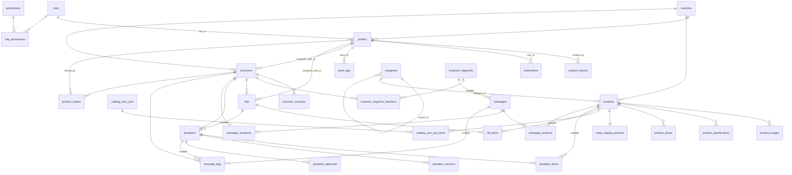

# TRONIC Response — Database ERD

All tables live in `supabase/migrations/0001…0009`. PostgreSQL with foreign
keys, unique constraints, indexes and RLS on every table. Country-aware via
`countries` for future expansion.

## Table inventory (33 tables + 2 views)

| Group | Tables | Key constraints |
| --- | --- | --- |
| Identity/RBAC | users (Supabase `auth.users`), profiles, roles, permissions, role_permissions, countries | profile 1:1 auth user; role matrix seeded |
| Products | categories, products, product_images, product_specifications, product_prices, product_imports | `products.sku` unique; one primary image per product (partial unique); price history append-only; GIN trigram on `search_text` |
| Meta sync | meta_catalog_products, catalog_sync_jobs, catalog_sync_job_items | unique `(meta_catalog_id, retailer_id)`; payload hash skip |
| Customers | customers, customer_segments, customer_segment_members, customer_consents | unique whatsapp_phone + respondio_contact_id; consents append-only, latest wins (`current_customer_consents` view) |
| RFQ/Quotes | rfqs, rfq_items, quotations, quotation_items, quotation_versions, quotation_approvals | `rfqs.idempotency_key` unique; sequential refs (RFQ-YYYY-NNNNN / QT-YYYY-NNNNN); immutable version snapshots |
| Campaigns/Msg | campaigns, campaign_products, campaign_recipients, message_logs, product_shares | DB trigger enforces ≤30 products per campaign (Meta limit); unique (campaign, customer) prevents duplicate sends; message dedupe on provider id |
| System | webhook_events, notifications, integration_settings, audit_logs | unique `dedupe_key`; audit append-only; secrets encrypted at app layer |
| Views | current_product_prices, current_customer_consents | `distinct on` latest-row resolution |

## Enum types

`app_role`, `product_visibility`, `product_availability`, `price_type`,
`import_status`, `sync_status`, `sync_job_type`, `sync_job_status`,
`consent_channel`, `consent_status`, `rfq_source`, `rfq_status`,
`quotation_status`, `approval_decision`, `campaign_type`, `campaign_status`,
`message_direction`, `message_status`, `message_kind`, `webhook_status`,
`notification_kind` — defined in `0001_extensions_and_enums.sql`.

## Storage buckets

| Bucket | Access |
| --- | --- |
| product-images | public read, staff (`products.write`) manage |
| quotations | private — staff read via RLS, customers via short-lived signed URLs |
| imports | private — staff (`products.write`) only |
