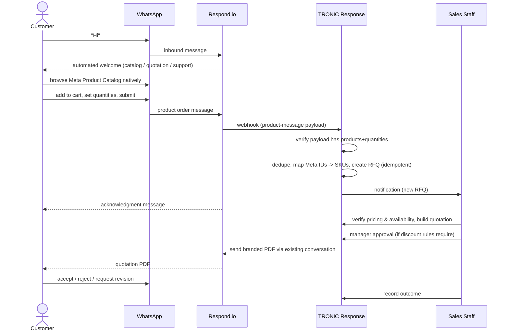

# TRONIC Response — Application Flows

## 1. Customer flow (WhatsApp-first)



Fallbacks: payload without items → event `ignored`, staff create a manual
RFQ; unsupported webhook capability → manual RFQ from the Respond.io inbox;
customer who needs deep filtering → optional external catalog
(EN/SW, no registration) with Request Quotation + Talk to Sales.

## 2. Staff flows

### 2.1 Catalog operations (Super Admin / staff with products.write)
Import Excel/CSV (SKU upsert, validation report) → add images (SKU-matched)
→ publish → sync to Meta Catalog (eligibility validation, hash-skip,
batch push, per-item retry) → monitor on Meta Catalog screen.

### 2.2 RFQ handling (Sales Manager → Sales Staff)
New RFQ notification → manager assigns (or staff picks up) → review items
(unmapped lines flagged) → Create Quotation (copies mapped items, snapshots
current retail price as list price) → edit prices/discounts/taxes/validity →
submit for approval if needed → approved → generate PDF → send via
WhatsApp → record accept/reject/revision → complete.

### 2.3 Direct sharing (Sales Staff)
Search product (SKU/name/model/spec) → select one or many → preview →
pick customer → send (image+description, native product message where
verified, or catalog link) → history recorded. Respond.io's native sharing
UI remains available where it is the simplest workflow.

### 2.4 Broadcasting (Marketing → Manager)
Pick products (≤30 for multi-product) or full catalog → choose segment →
approved template → preview → submit for approval → manager approves →
schedule → execute via Respond.io Broadcast module → suppression check
(opt-outs) at send time → track delivery/engagement where available.

## 3. Quotation status machine

```
New → Assigned → Under Review → Prepared → Approved → Sent
  Sent → Accepted → Completed
  Sent → Rejected
  Sent → Revision Requested → Under Review (new version, snapshot kept)
(any) → Cancelled · Sent → Expired (validity passed)
```

Accepted ≠ paid. Payments are Phase 2
(Accepted Quotation → Payment Request → Verified Payment → Receipt → Order Confirmation).
