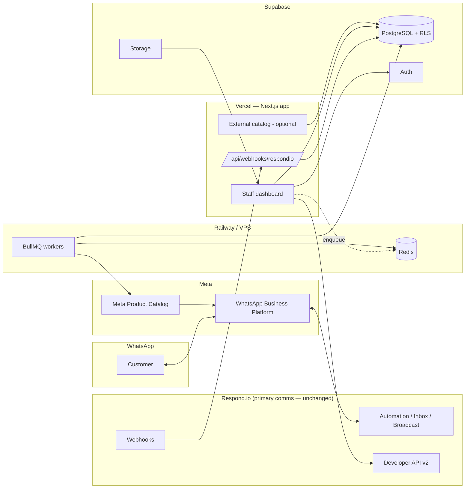

# TRONIC Response — Technical Requirements Document (TRD)

**Version:** 1.0 · **Date:** 2026-11-24

## 1. System architecture

Modular monolith. One Next.js codebase hosts the staff dashboard, the
optional external catalog and the webhook API; background workers deploy
separately. Clear internal boundaries: `modules/` (business services) never
import provider SDKs directly — they go through `integrations/` adapters.

**Independence rule:** no connection to the TRONIC e-commerce site, Shopify,
SAP, POS or existing website admin. Provider outages never block core
product/quotation management: webhooks are stored first and retried from our
own table; catalog pushes queue until Meta recovers; Respond.io sends are
queued/flagged for manual fallback.

## 2. Technology choices

| Concern | Choice | Notes |
| --- | --- | --- |
| Web + API | Next.js (App Router), React, TypeScript | Server Components + Server Actions |
| Styling | Tailwind CSS 4 | Brand tokens in `globals.css` `@theme` |
| Database | Supabase PostgreSQL | Authoritative product DB; RLS everywhere |
| AuthN/Z | Supabase Auth + `profiles`/`roles`/`permissions` | RBAC enforced in API layer AND RLS |
| Files | Supabase Storage | `product-images` (public), `quotations`, `imports` (private) |
| Queues | Redis + BullMQ | catalog-sync, webhook-retry; exponential backoff; failed jobs retained (dead-letter) |
| Hosting | Vercel (web), Railway/VPS (workers + Redis) | GitHub-driven deploys |

## 3. Integration specifications

### 3.1 Respond.io (adapter: `src/integrations/respondio/client.ts`)

Base: `https://api.respond.io/v2`, bearer token. 429s honored with
`retry-after` backoff. **Capability verification policy:** before any
dependent feature goes live, the endpoint is verified against the actual
workspace subscription (plan, API permissions, webhook payloads, message
types). Methods marked `verified: pending` must not be used by core flows.
No invented endpoints. The existing WhatsApp number is never disconnected
or migrated.

| Capability | Endpoint (v2) | Status |
| --- | --- | --- |
| Get contact | `GET /contact/{id}` or `/contact/phone:{E164}` | standard |
| List contacts | `POST /contact/list` | standard |
| Tag contact | `POST /contact/{id}/tag` | standard |
| Send text/attachment | `POST /contact/{id}/message` | standard |
| Send approved template | `POST /contact/{id}/message` (whatsapp_template) | standard |
| Assign conversation | `POST /contact/{id}/conversation/assignee` | verify per plan |
| Product-message webhook (cart/order) | inbound webhook | **verify payload shape per plan** |
| Native broadcast via API | — | NOT assumed; Respond.io Broadcast UI is the engine |

Webhook endpoint `/api/webhooks/respondio`:
1. HMAC-SHA256 signature check when `RESPONDIO_WEBHOOK_SECRET` set (reject on mismatch).
2. Parse → dedupe key = provider message id (or payload SHA-256).
3. Insert into `webhook_events` (unique dedupe_key → duplicate deliveries acknowledged, not reprocessed).
4. Process: order/cart payload → RFQ pipeline; other inbound → message log. Failures stay `failed` for the retry worker.
5. Always fast-200 to avoid provider retry storms.

### 3.2 Meta Product Catalog (adapter: `src/integrations/meta/catalog-client.ts`)

Graph API `v21.0`; system-user token with `catalog_management`.

| Operation | Endpoint |
| --- | --- |
| Upsert items (batch ≤100) | `POST /{catalog_id}/items_batch` (`method: UPDATE`, `retailer_id` = SKU) |
| Delete items | `POST /{catalog_id}/items_batch` (`method: DELETE`) |
| Batch status / per-item errors | `GET /{catalog_id}/check_batch_request_status` |
| Find by retailer_id | `GET /{catalog_id}/products?filter=…` |

Sync pipeline (worker `catalog-sync`): select published products → eligibility
validation (name, primary image, publishable retail price, not discontinued)
→ payload-hash skip for unchanged items → batch push → per-item results in
`catalog_sync_job_items` → statuses on `products.meta_sync_status` and
`meta_catalog_products`. Duplicate prevention: unique `(catalog, retailer_id)`.
**Never pushed:** wholesale prices, internal notes, draft/archived products.
Published price carries the disclaimer "subject to quotation confirmation";
products without a publishable price are excluded (external RFQ catalog only).

### 3.3 WhatsApp cart → RFQ (`src/modules/rfq/create-from-cart.ts`)

- Defensive payload extraction (plan-dependent shapes), requires items with
  product reference + positive quantity; otherwise event is `ignored` and
  staff use the manual RFQ fallback.
- Idempotency: webhook dedupe_key is stored as `rfqs.idempotency_key`
  (unique) — concurrent/duplicate deliveries resolve to the same RFQ.
- Mapping: retailer_id → `products.sku`; fallback Meta product id →
  `products.meta_product_id`; unmapped items kept with
  `mapping_status='unmapped'` for staff review.
- Customer find-or-create by Respond.io contact id, then phone (unique);
  contact id backfilled.
- Notifications fan out to sales managers + super admins.

## 4. Security architecture

- **RBAC:** 4 roles × 22 permissions (`role_permissions`), enforced
  server-side (`requirePermission`) and in RLS policies
  (`public.has_permission()` security-definer).
- **RLS:** enabled on all 33 tables. Wholesale prices readable only with
  `quotations.write`/`products.write`. RFQs visible to assignee/managers.
  `webhook_events`, `audit_logs` writes are service-role only.
- **Secrets:** environment variables (Vercel/Railway encrypted). Service-role
  key server-only. `integration_settings.secrets_enc` encrypted (AES-256-GCM)
  when DB-stored credentials are required.
- **Webhooks:** HMAC verification (when supported), store-then-process,
  dedupe, our-side retries.
- **Idempotency:** RFQ creation; catalog upserts (retailer_id); campaign
  recipient uniqueness; message log dedupe on provider message id.
- **Documents:** quotation PDFs in private bucket; customers receive
  short-lived signed URLs only.
- **Messaging compliance:** 24-hour window respected — outside it only
  approved templates; marketing requires `whatsapp_marketing` consent;
  opt-outs suppressed at send time and recorded immutably.
- **Audit:** `audit_logs` (actor, action, entity, before/after, IP).
- **Backups:** Supabase PITR + daily dumps (Phase 1E runbook).

## 5. Reliability

- BullMQ: 5 attempts, exponential backoff, failed jobs retained for
  inspection (dead-letter) and surfaced on the Integrations screen.
- Rate limits: Respond.io 429 retry-after; Meta batches ≤100, worker
  concurrency 1.
- Health monitoring: provider health checks recorded in
  `integration_settings.health_status`; config presence surfaced in UI.
- Graceful degradation: every integration feature has a manual fallback
  (manual RFQ, Respond.io native sharing/broadcast UI).

## 6. Performance

- Product search: generated `search_text` column + GIN trigram index —
  sub-50ms lookups across 10k products.
- List endpoints paginated (≤100 rows); imports stream row-by-row with
  bounded error collection; catalog sync batches of 100.
- Current prices resolved via `current_product_prices` view
  (`distinct on` + composite index).

## 7. Testing & deployment plan (Phase 1E)

- **Unit:** import parser/validator, eligibility validation, payload
  extraction, RFQ idempotency.
- **Integration:** webhook route (signature, dedupe, duplicate delivery),
  RLS policies per role (pgTAP or supabase test harness).
- **E2E:** staff login → product import → publish → sync (mock Meta) →
  simulated cart webhook → RFQ → quotation.
- **Security:** RLS bypass attempts per role, webhook forgery, signed-URL
  expiry; dependency audit.
- **Performance:** 10k-product import, catalog sync, dashboard aggregates.
- **Deployment:** GitHub → Vercel preview → production promote; workers via
  Railway; migrations applied with `supabase db push` gated in CI; rollback =
  redeploy previous build + migration down scripts for destructive changes
  (avoided by additive-only policy).
